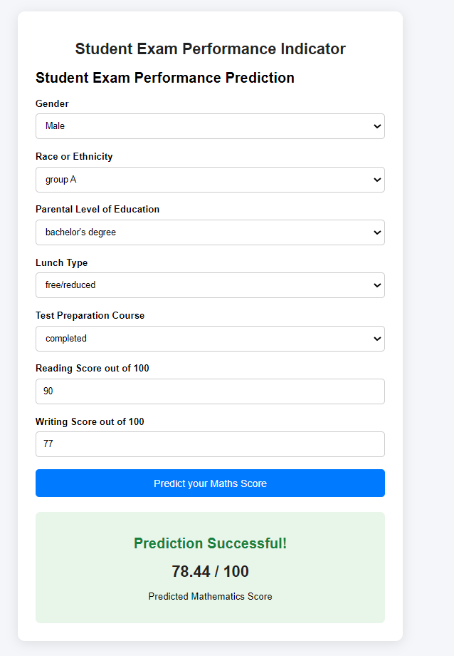
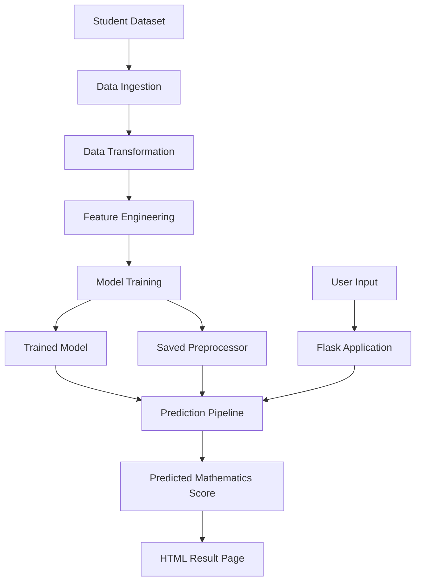
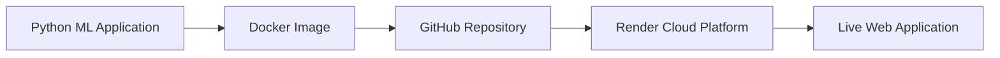

# 🎓 Student Performance Predictor

<p align="center">

  **An End-to-End Machine Learning Web Application for Student Mathematics Score Prediction**

  <br/>

  [](https://www.python.org/)
  [](https://flask.palletsprojects.com/)
  [](https://scikit-learn.org/)
  [](https://www.docker.com/)
  [](https://render.com/)

  <br/>

  **[🌐 Live Demo](https://student-performance-predictor-wnbe.onrender.com)**
  |
  **[📂 GitHub Repository](https://github.com/kalakanhuswain18-hub/student-performance-predictor)**

</p>

---

## 📌 Project Overview

Student Performance Predictor is an end-to-end Machine Learning web application that predicts students' Mathematics examination scores based on demographic information, parental education, lunch type, test preparation course, and Reading and Writing scores.

The project demonstrates a complete Machine Learning workflow, from data ingestion and preprocessing to model training, prediction, and cloud deployment.

The application uses Flask for its web interface and Docker for containerization. It is deployed on Render.

## 🌐 Live Application

**Try the application here:**

👉 https://student-performance-predictor-wnbe.onrender.com

Users can enter student information and receive a predicted Mathematics score out of 100.

> Note: The Render free instance may spin down after periods of inactivity. The first request after inactivity may take longer.

---

## 📸 Application Screenshot

### Student Performance Prediction Interface



### Example Prediction

| Input | Value |
|---|---:|
| Reading Score | 90 |
| Writing Score | 77 |
| Predicted Mathematics Score | 78.44 / 100 |

*Example result captured from the deployed application.*

---

## ✨ Key Features

- Student Mathematics score prediction.
- Interactive and user-friendly Flask interface.
- Data ingestion pipeline.
- Automated data preprocessing and transformation.
- Feature engineering and encoding.
- Machine Learning model training.
- Model and preprocessor serialization.
- Modular prediction pipeline.
- Docker containerization.
- Cloud deployment using Render.
- Git and GitHub version control.

---

## 🛠️ Tech Stack

| Category | Technologies |
|---|---|
| Programming Language | Python |
| Data Analysis | Pandas, NumPy |
| Data Visualization | Matplotlib, Seaborn |
| Machine Learning | Scikit-Learn |
| ML Algorithms / Libraries | CatBoost, XGBoost |
| Backend Framework | Flask |
| Model Serialization | Dill |
| Frontend | HTML, CSS |
| Containerization | Docker |
| Production Server | Gunicorn |
| Cloud Deployment | Render |
| Version Control | Git, GitHub |
| Development Environment | VS Code, Jupyter Notebook |

---

## 📊 Input Features

The application accepts the following student information:

| Feature | Description |
|---|---|
| Gender | Student gender |
| Race or Ethnicity | Student ethnicity group |
| Parental Level of Education | Parents' education level |
| Lunch Type | Standard or free/reduced |
| Test Preparation Course | None or completed |
| Reading Score | Reading examination score |
| Writing Score | Writing examination score |

**Target Variable:** Mathematics Score

**Output:** Predicted Mathematics examination score out of 100.

---

## 🏗️ Project Architecture

The project follows a modular Machine Learning pipeline architecture.

### Machine Learning Workflow



### Deployment Workflow



---

## 📁 Project Structure

```text
Student-Performance-Predictor/
│
├── artifacts/
│   ├── model.pkl
│   ├── preprocessor.pkl
│   ├── train.csv
│   └── test.csv
│
├── notebook/
│   └── EDA and Model Training Notebooks
│
├── screenshots/
│   └── prediction-result.png
│
├── src/
│   │
│   ├── components/
│   │   ├── data_ingestion.py
│   │   ├── data_transformation.py
│   │   └── model_trainer.py
│   │
│   ├── pipeline/
│   │   ├── predict_pipeline.py
│   │   └── train_pipeline.py
│   │
│   ├── exception.py
│   ├── logger.py
│   └── utils.py
│
├── templates/
│   └── home.html
│
├── app.py
├── application.py
├── Dockerfile
├── .dockerignore
├── .gitignore
├── requirements.txt
├── setup.py
└── README.md
```

---

## ⚙️ Installation and Setup

Follow these steps to run the project locally.

### 1. Clone the Repository

```bash
git clone https://github.com/kalakanhuswain18-hub/student-performance-predictor.git
```

### 2. Navigate to Project Directory

```bash
cd student-performance-predictor
```

### 3. Create a Virtual Environment

```bash
python -m venv venv
```

### 4. Activate Virtual Environment

**Windows PowerShell:**

```powershell
venv\Scripts\Activate.ps1
```

**Windows CMD:**

```cmd
venv\Scripts\activate
```

### 5. Install Dependencies

```bash
pip install -r requirements.txt
```

### 6. Run the Flask Application

```bash
python app.py
```

### 7. Open in Browser

```text
http://127.0.0.1:5000
```

---

## 🐳 Docker Deployment

The application is containerized using Docker.

### 1. Build Docker Image

```bash
docker build -t student-performance-predictor .
```

### 2. Run Docker Container

```bash
docker run -d -p 10000:10000 --name student-predictor student-performance-predictor
```

### 3. Check Running Containers

```bash
docker ps
```

### 4. View Container Logs

```bash
docker logs student-predictor
```

### 5. Open Application

```text
http://localhost:10000
```

---

## ☁️ Cloud Deployment – Render

The Student Performance Predictor is deployed on Render using Docker.

### Deployment Configuration

| Configuration | Value |
|---|---|
| Hosting Platform | Render |
| Runtime | Docker |
| GitHub Branch | main |
| Production Server | Gunicorn |
| Instance Type | Free |
| Container Port | 10000 |

### Deployment Process

1. Push the project to GitHub.
2. Connect the GitHub repository to Render.
3. Create a new Web Service.
4. Select Docker as the runtime.
5. Configure the free instance.
6. Deploy the application.
7. Access the generated public URL.

**Live Application:**

https://student-performance-predictor-wnbe.onrender.com

---

## 📈 Machine Learning Pipeline

The project is organized into modular components.

### 1. Data Ingestion

- Loads the dataset.
- Splits data into training and testing datasets.
- Stores the resulting datasets.

### 2. Data Transformation

- Handles numerical and categorical features.
- Performs missing value handling.
- Applies encoding to categorical variables.
- Applies feature scaling where required.
- Saves the preprocessing object.

### 3. Model Training

- Trains Machine Learning models.
- Evaluates model performance.
- Selects the best-performing model.
- Saves the trained model.

### 4. Prediction Pipeline

- Accepts user input.
- Converts input into a DataFrame.
- Loads the saved preprocessor.
- Transforms input features.
- Loads the trained model.
- Generates the predicted Mathematics score.

---

## 🔮 Future
